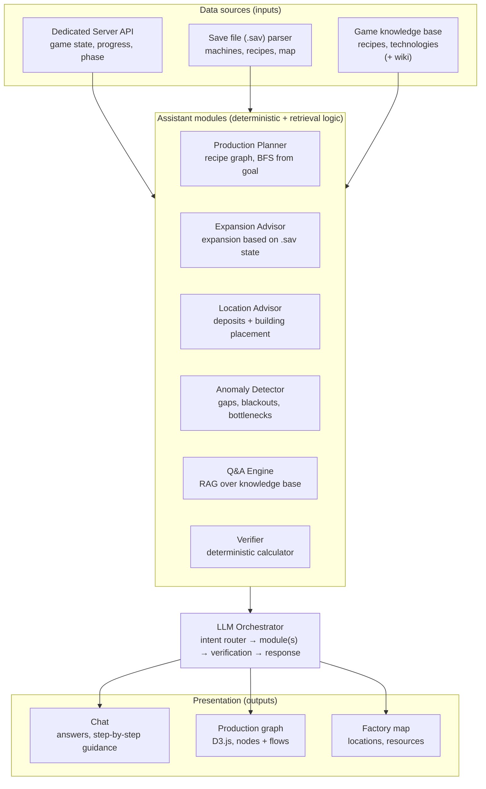
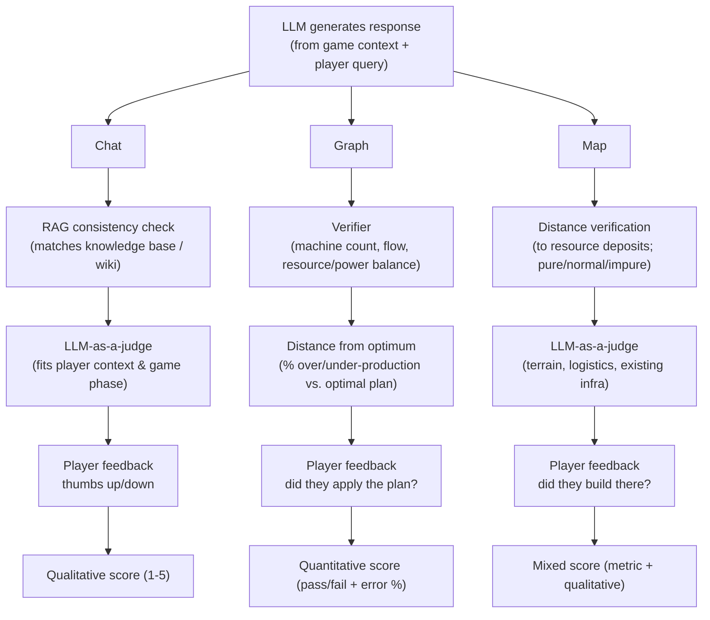

# Pioneer — Satisfactory AI Planning Assistant — Architecture

> Source: distilled from `Satisfactory AI Planner.pdf` (project vision deck). This document is the
> canonical architecture reference for both human contributors and AI coding agents working in
> this repository. If code and this document disagree, treat this document as the intended design
> and either fix the code or update this file in the same change — don't let them silently drift.

## 1. Problem statement

[Satisfactory](https://www.satisfactorystation.com/) is a first-person factory-building game
(Coffee Stain Studios, 2019 early access → 2024 full release, 5.5M+ copies sold). The player lands
on an alien planet and must build an increasingly complex factory for the FICSIT corporation:
extract raw resources, automate their processing, and chain together production lines to hit
throughput goals (e.g. "produce 10 units of X per minute"). As the game progresses, recipes,
machines and logistics options multiply, and production chains span multiple factories scattered
across a large, *fixed* map (resource deposits never move and never run out — this determinism is
what makes the problem tractable for tooling).

By the late game the planning problem is genuinely hard:

- Many production nodes, each requiring its own factory.
- Factories must be distributed across the map because resources are geographically constrained.
- This becomes a large combinatorial optimization + logistics problem (belt/pipe throughput,
  power balance, alternate recipes, tech unlock ordering).

Community tools already exist (e.g. satisfactorytools.com) but share three weaknesses this project
is meant to fix:

1. All game state must be entered by hand — there's a lot of it.
2. They don't know what the player has *already built* (no save-file awareness).
3. They don't reason about *map location* (where deposits are, what's already nearby).

**Pioneer** is an AI assistant that removes all three limitations by reading the player's actual
game/server state and reasoning over it directly.

## 2. Scope

### In scope (what the assistant does)

- Optimize existing production chains.
- Plan logistics: belt/pipe throughput and routing.
- Extend existing production chains to hit new targets.
- Design new factory plans from scratch.
- Recommend alternate recipes.
- Plan the power grid.
- Advise on technology unlock order.
- Answer general game-mechanics questions.
- Visualize proposed plans as graphs and map overlays.
- Keep one plan per conversation: revise it on request instead of planning anew, and follow how far
  the player has built it.

### Out of scope / known limitations

- Requires a **dedicated server** (no support for listen-server/hosted-by-client play).
- **Singleplayer only** for v1.
- The save file is only a **snapshot** of the factory at load time, not a live stream — state can
  go stale between reads.
- **No vehicle or train/rail planning.**

Design implication: every module must degrade gracefully when a data source is missing or stale
(e.g. no dedicated server reachable → the assistant can still answer static Q&A and produce
theoretical plans, just without "what do I already have" context).

## 3. Architectural pattern: LLM agent with tool use

Pioneer is **not** a chatbot that generates factory plans by free-form generation. It is an
**LLM agent with tool use** wrapped around **deterministic engineering code**:

- The LLM's job is to *reason and plan*: understand player intent, decide which module(s) to
  invoke and in what order, and turn structured module output into a natural-language answer.
- The LLM **never** computes production math itself (machine counts, throughput, power balance,
  distances). Every number in a response must be traceable to a deterministic module.
- All domain calculations live in plain, testable, deterministic code — the LLM calls into them as
  tools/functions, the same way it would call any other API.

This split is the single most important invariant in the system: **reasoning is probabilistic,
arithmetic is deterministic.** Keep them in separate code paths so the deterministic half can be
unit-tested without ever invoking a model.

### 3.1 LLM runtime

The LLM runs **locally**, not against a hosted provider API. Every module that talks to it
(Orchestrator, Q&A Engine) does so through an **OpenAI-compatible chat/completions endpoint** —
that interface is the fixed assumption; the specific local backend behind it (Ollama, llama.cpp,
vLLM, LM Studio, ...) is swappable without touching calling code. Config
(`pioneer.config.Settings`) exposes this as `llm_base_url` + `llm_model`, with `llm_api_key`
optional since most local setups don't require one.

## 4. High-level data flow

### 4.1 Data layer

| Source | Provides | Freshness |
|---|---|---|
| Dedicated server API | live game state, player progress, current tech phase | live |
| Save file (`.sav`) parser | placed machines, configured recipes, map/building layout | snapshot at load time |
| Static game knowledge base | recipes, buildings, technologies (from game files) | static, ships with the assistant |
| Static resource database | resource node locations, purity (impure/normal/pure) | static, ships with the assistant |
| Game wiki | supplementary lore/mechanics text for Q&A | static, periodically refreshed |

All five are treated as read-only inputs. No module ever writes back to the game or the save file.

### 4.2 Assistant modules (logic layer)

Each module is an independently testable unit with a narrow responsibility. The LLM Orchestrator
calls modules as tools; modules never call the LLM directly. The two exceptions are the Q&A
Engine's answer synthesis and the LLM-as-a-judge hooks of the verification module (§6) — both take
the model call as an injected callable, so the modules themselves stay testable without one.

| Module | Responsibility | Primary inputs | Nature |
|---|---|---|---|
| **Production Planner** | Given a target output rate — or several, for a plan with more than one target — build/extend a recipe graph via BFS/graph search from the goal backward to raw resources | Knowledge base | Deterministic |
| **Expansion Advisor** | Given a new target and the player's *existing* factories (from `.sav`), decide the minimal set of changes (extend factory A, add a linking stage, etc.) instead of planning from scratch; given two versions of the player's plan, say what changes between them (machines to add, take down, or switch to another recipe) | `.sav` state, Production Planner, Verifier | Deterministic |
| **Location Advisor** | Recommend where to place new buildings, based on remaining unclaimed deposits and their purity/distance | Static resource DB, `.sav` state | Deterministic |
| **Anomaly Detector** | Scan the current factory for problems: under/over-production gaps, power blackouts, belt/pipe congestion | `.sav` state, Verifier | Deterministic |
| **Q&A Engine** | Answer free-form game-mechanics questions | Knowledge base + wiki via RAG | Retrieval + LLM |
| **Verifier** | Ground-truth calculator: machine counts, throughput, resource balance, power balance — and how far the player has built their plan | Knowledge base, module outputs, `.sav` state | Deterministic |

The **Verifier** is a shared dependency, not a leaf module: it's where the Expansion Advisor's
spare capacity, the Anomaly Detector's balances and every figure in an answer come from — through
the Orchestrator, which is what calls modules for each other (§4.3). Treat it as the single source
of truth for "is this plan numerically valid."

The one deliberate exception is the Production Planner, which counts its own machines in two lines
rather than importing the Verifier: that keeps it dependent on the shared contracts alone, like
every other module, and its output is checked against the Verifier anyway, both in the
verification step and by the end-to-end tests.

### 4.3 LLM Orchestrator

The orchestrator is the only component allowed to talk to the LLM for planning purposes (the Q&A
Engine's RAG step is the other LLM touchpoint, scoped to answer synthesis). Its loop:

1. **Route intent** — classify what the player is asking for (new plan / expand existing / locate
   a factory / diagnose a problem / general question).
2. **Invoke module(s)** — call the relevant module(s) above as tools, in whatever order the intent
   requires (e.g. Production Planner → Verifier → Expansion Advisor).
3. **Verify** — pass module output through the Verifier (and, where relevant, an LLM-as-a-judge
   pass — see §6) before it reaches the player.
4. **Respond** — compose the final answer across the three presentation channels (§4.4).

Because the orchestrator only ever receives already-verified, structured module output, its own
failure mode is limited to *misrouting* or *poor phrasing* — it cannot introduce arithmetic errors.

#### The player's plan

A conversation can hold one plan: the production chain the player is working towards, kept as
structured state (`contracts.Plan`) rather than as text in the chat history. It's what turns a
follow-up into a change of that plan instead of a fresh one that happens to look similar:

- **Proposed, then accepted.** An answer that plans a chain or an expansion offers it as the
  conversation's plan; it becomes the plan only once the player accepts it. Every later turn of the
  conversation runs with the plan in the Orchestrator's context: the model is shown it — its
  targets, every stage, how much of each is built — and gets two more tools, to draw it and to
  revise it.
- **Revised deterministically.** The plan pins what it was planned from: its targets, the recipe
  each stage runs and, for an expansion, the existing factory's spare output at the time. A
  revision changes only what the player asked for and plans the rest from the same parameters, so
  the deterministic planner gives every stage they didn't touch back unchanged — the model never
  re-derives the plan, it only names the change. The Expansion Advisor says what the revision
  changes, and the revision is a proposal for the player to accept like the first plan was.
- **Progress from the save.** The Verifier counts how far the plan is built: the save's buildings
  of each stage's recipe beyond what stood when that recipe came into the plan — buildings, not
  clock-scaled machines, so underclocking doesn't read as unbuilt. The player can mark a stage
  built before the save shows it, and a mark counts like a building. The model and the page are
  handed the same numbers.

That keeps invariant #1 (§7): rates, machine counts, what a revision changes and how much stands
all come from deterministic code; the model only decides which change the player asked for. The
plan is the conversation's, so it lives with the conversation (the web layer's store), and the
Orchestrator gets it handed in like every other piece of context.

### 4.4 Presentation layer

A single assistant response is composed of three parts, rendered together:

| Channel | Content | Notes |
|---|---|---|
| **Chat** | Natural-language answer, step-by-step instructions, general Q&A | Primarily prose; wraps the other two channels in words |
| **Production graph** | The proposed/updated production chain | Rendered client-side with D3.js; nodes = machines/recipes, edges = material flow |
| **Factory map** | Proposed or referenced factory location(s) | Overlaid on the static map; shows resource nodes and purity |

Not every response needs all three — a pure Q&A answer may only populate Chat.

Beside the responses, a conversation with a plan (§4.3) shows it in a bar over the chat — what it
makes and how much of it is built — which opens into a panel: every stage's progress, a box to
mark a stage built, a link to the plan's graph, and the revisions the plan went through.

## 5. Example end-to-end flow

> "I want to produce 10/min of resource X."

1. Player states the goal in Chat.
2. Orchestrator pulls current state from the dedicated server and the latest `.sav`.
3. Orchestrator asks the knowledge base for X's recipe(s).
4. Production Planner walks the existing production graph (from `.sav`) to see what's already
   built toward X or its inputs.
5. Planner determines the minimal change: extend two existing factories and add one new stage
   joining their outputs — no new factory needed.
6. Verifier checks the resulting graph balances (inputs/outputs, machine counts, power).
7. Orchestrator responds: Chat explains the required changes, Graph shows the updated production
   chain highlighting what's new vs. what already existed.
8. The page offers the plan to be accepted as the conversation's plan (§4.3).

### 5.1 Following up on the plan

> "Make it 20/min, and add 5/min of Rotors."

1. The conversation has a plan the player accepted. The Orchestrator's context carries it, and the
   model is shown its stages and how far the latest save has built them.
2. The model calls the revise tool with just the change: one target's new rate, and a new target.
3. The Production Planner plans both targets with the plan's pinned recipes — and, for a plan
   extending the factory, against the same spare output as before.
4. The Expansion Advisor compares the revision with the plan: machines to add, to take down, or to
   switch over to another recipe — and, by the Verifier's count of the save, how many of those
   already stand.
5. Orchestrator responds: Chat says what would change, Graph draws the revised plan, and the page
   offers to accept it. Accepted, it's the plan the next turn works on, its revision noted in the
   plan's history.

## 6. Verification & feedback

Every response type has its own verification pipeline, ending in player feedback that should be
captured and fed back into quality tracking (this is evaluation infrastructure, not a gate that
blocks responses from being sent):

Three verification styles, matching the legend from the source design:

- **Deterministic** — Verifier, distance calculations: pure code, no LLM, exact pass/fail.
- **LLM-as-a-judge** — RAG consistency review, contextual/terrain fit: a second LLM pass scoring
  the *first* LLM's output against retrieved ground truth or contextual fit. Never used for
  arithmetic, only for subjective/contextual fit.
- **Player feedback** — thumbs up/down or behavioral signal (did they apply the plan / build at
  the suggested spot), the ultimate ground truth signal for model/prompt iteration.

Implication for implementation: every module's output should be structured (not just prose) so
that the Verifier and LLM-as-a-judge stages have something concrete to check against, and so
player feedback can be attached to a specific plan/graph/location rather than a whole chat session.

## 7. Design invariants (read this before writing code)

1. **No arithmetic in the LLM path.** Anything numeric (rates, machine counts, distances, power)
   is computed by the Verifier or another deterministic module and passed to the LLM as already-
   computed structured data.
2. **Read-only game access.** No module writes to the dedicated server or `.sav` file.
3. **Static data ships with the assistant.** Knowledge base and resource DB are versioned data
   sets, decoupled from live game/server calls — building/testing modules doesn't require a
   running game instance.
4. **Modules are independently testable.** Each module in §4.2 should have a stable input/output
   contract (plain data structures in, plain data structures out) so it can be unit-tested without
   the orchestrator or an LLM in the loop.
5. **Graceful degradation.** If the dedicated server is unreachable or no `.sav` is loaded, the
   assistant still answers using knowledge base + Q&A Engine only, and says so explicitly rather
   than guessing at factory state.
6. **Every response is attributable.** Any claim in a Chat answer, any edge in a Graph, any pin on
   the Map must trace back to a specific module call, so verification (§6) and player feedback can
   target it precisely.

## 8. Module boundaries

Each module lives in its own package under `src/pioneer/` and may import `pioneer.contracts` —
plain data definitions with a few derived values (`Coordinates.distance_to`,
`Recipe.output_rate`), no I/O — and `pioneer.common`, small helpers several modules need (readable
names for class ids, recipe and machine counting, atomic file writes), which imports nothing but
the contracts. Nothing else of this project's: that keeps every module testable on its own,
against hand-written fixtures. The exceptions are the integration layers: the Orchestrator, which
calls every module; verification scoring, which calls the Verifier; the LLM transport; and the
app, the web UI and the launcher, which wire everything together. `tests/test_architecture.py`
enforces the rule and lists every exception.

Tests mirror the package layout under `tests/`, each module with its own fixtures next to its
tests. Where real data is committed (`assets/en-US.json`, the save files under
`tests/save_parser/fixtures/`), a second suite runs the same code against it.
